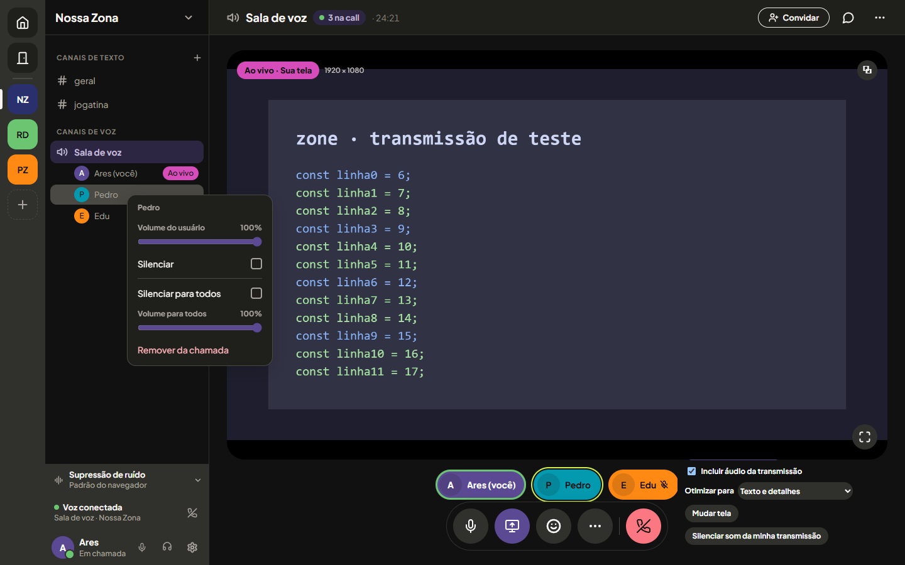
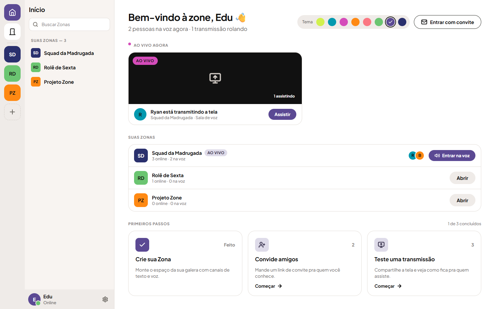
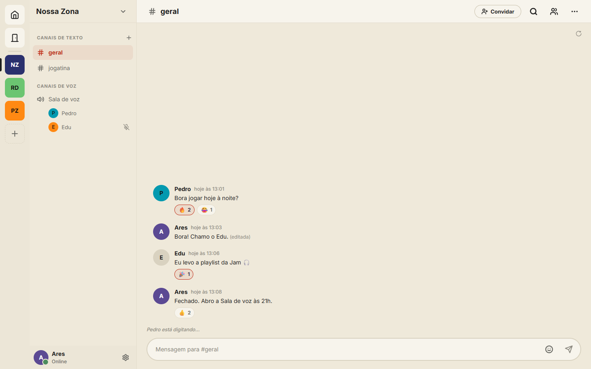
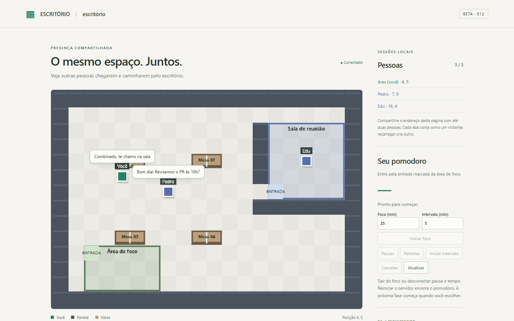
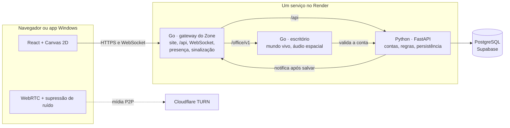
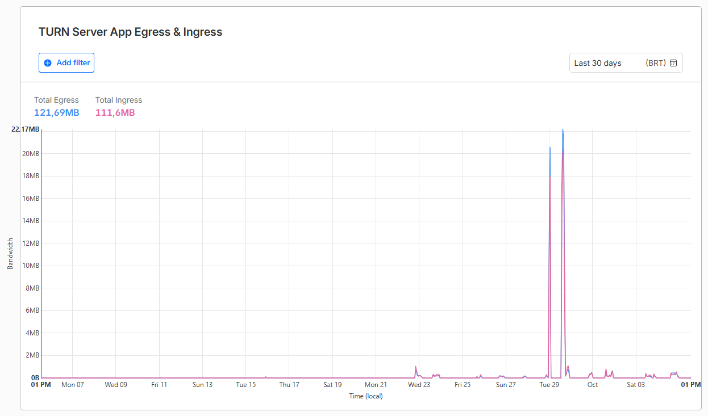

# Zone

### Chamadas de voz, chat e um escritório virtual 2D para equipes pequenas

**Python · Go · TypeScript/React · PostgreSQL · WebRTC · Canvas 2D**

Projeto pessoal, em uso real por um grupo de três pessoas, hospedado no Render
com TURN da Cloudflare e cliente para Windows.

> **Repositório vitrine.** O código completo é privado. Aqui estão a visão geral, as
> decisões de arquitetura, os problemas que enfrentei, os resultados medidos e
> [amostras reais do código](amostras/). Posso dar acesso de leitura ao repositório
> completo para avaliação técnica, é só pedir.

Ares compartilha a tela numa chamada com Pedro e Edu. O clique direito na foto de uma pessoa abre as opções dela: volume e silenciar só para mim e, para administradores, para todos. Embaixo, a supressão de ruído e a "Voz conectada", que continuam visíveis em qualquer tela.

---

## Sobre

O Zone começou como um lugar para eu e dois amigos conversarmos por texto e voz sem
depender de serviços grandes. Virou meu projeto de estudo de sistemas em tempo real:

- **Zone Call**: Zonas (servidores), canais de texto com histórico e mensagens ao vivo,
  chamada de voz para até 3 pessoas, compartilhamento de tela, moderação e app Windows.
- **Escritório virtual**: um mapa 2D em grade onde a distância entre as pessoas
  define quem se ouve, com salas de reunião, áreas de foco, mesas, pomodoro e chat local.

Os dois são **módulos independentes**: o escritório abre dentro do Zone com a mesma
conta, mas também roda sozinho. Nenhum importa código do outro.

| | |
| --- | --- |
| Período | setembro e outubro de 2026, em etapas pequenas |
| Tamanho | cerca de 32 mil linhas de código e 40 mil linhas de testes |
| Testes | mais de 2.800 automatizados (Go, Python, Vitest e fluxos reais no navegador) |
| Hospedagem | Render (um único serviço), Supabase PostgreSQL, Cloudflare TURN |

## Interface

Em outubro de 2026 a interface do Zone Call foi refeita a partir de um design no Figma.
Os tokens do arquivo (cores, tipografia, espaçamentos e raios) foram exportados e viraram
variáveis CSS, então a tela e o design usam os mesmos valores.

- **Temas**: claro ou escuro (segue o sistema até a pessoa escolher), estilo Zone ou
  和風 Wafū e 8 cores de destaque. O tema é aplicado antes do React carregar, sem piscar
  o tema errado.
- **Início ao vivo**: quem está em voz e quem está transmitindo em cada Zona, com
  atalho para assistir ou entrar.
- **Navegação sem espera**: a última lista vista aparece na hora e é confirmada em
  segundo plano; os 5 últimos canais de texto ficam guardados com o rascunho.
- **Acessível pelo teclado**: menus, diálogos e o recorte da foto funcionam sem mouse e
  têm rótulos para leitores de tela.

Início: a transmissão de Pedro aparece em destaque e cada Zona mostra quantas pessoas estão online e em voz.

Canal de texto no estilo Wafū: reações, mensagem editada e "digitando…". Na lateral, quem está na sala de voz aparece sem precisar entrar nela.

## Funcionalidades

**Zone Call**

- Cadastro por convite e login que dura até 30 dias, com renovação automática e segura.
- Canais de texto com histórico paginado, mensagens ao vivo, presença e "digitando…";
  editar, reagir (lista fechada de emojis) e buscar mensagens.
- Chamada de voz WebRTC entre os participantes, funcionando entre redes diferentes.
- **A chamada continua enquanto você navega** (Início, outras Zonas, Configurações e
  escritório) e só termina no botão de desconectar.
- Palco da chamada com cronômetro, anel em quem está falando, reações e ensurdecer.
- **Supressão de ruído com IA** no navegador, escolhida ao lado de "Voz conectada" em
  quatro níveis, dois com IA: DeepFilterNet3, GTCRN com portão de voz, a do navegador ou desligada.
- Compartilhamento de tela em até 1080p com áudio opcional, troca de fonte sem sair da
  chamada, modo "texto e detalhes" ou "movimento" e janela flutuante.
- Opções de cada pessoa no clique direito da foto, como no Discord: volume e silenciar
  só para mim; para administradores, silenciar e volume para todos e **remover da chamada**.
- Foto de perfil com recorte (arrastar, zoom e teclado), reduzida no navegador antes do envio.
- Configurações de perfil, voz e áudio, tela, notificações e sons, atalhos de teclado e
  conta (trocar a senha e sair dos outros aparelhos).
- **Jam do Spotify** compartilhado na chamada.
- App Windows (PySide6 + Qt WebEngine) com bandeja, notificações nativas, permissão do
  microfone lembrada e navegação restrita ao Zone.

**Escritório virtual**

- Um escritório para a instalação inteira, aberto pelo botão da porta na barra lateral.
- Movimento em 4 direções validado no servidor (colisão, velocidade e ordem).
- Áudio espacial: o volume cai com a distância e paredes bloqueiam o som.
- Salas de reunião isoladas, áreas de foco só com texto e conversa "trancada" com consentimento.
- Mesas, pomodoro individual, chat local com balões e mensagens privadas.
- Convite de reunião que reserva uma sala e leva as duas pessoas juntas.

Escritório virtual com três pessoas, visto por Ares. Ares e Pedro estão perto e se ouvem; os balões mostram o chat local. Edu está na sala de reunião e não recebe a fala de quem está fora.

## Arquitetura

| Parte | Responsabilidade |
| --- | --- |
| Python (FastAPI) | Autenticação, autorização, regras de negócio, persistência, credenciais TURN temporárias, fotos de perfil |
| Go (gateway do Zone) | Porta pública: site, proxy da API, WebSocket autenticado, presença, distribuição de mensagens já salvas, sinalização da chamada |
| Go (escritório) | Estado autoritativo do mapa: posição, ocupação, quem ouve quem, reuniões |
| TypeScript | Interface com os tokens do Figma, Canvas, captura e reprodução de mídia, supressão de ruído |

Princípios que guiaram as decisões:

- **Uma regra, um dono.** Python decide quem pode o quê; Go aplica ao vivo; o cliente
  só envia intenções ("andar para a direita"), nunca "estou em x, y".
- **Privacidade decidida no servidor.** Quem recebe áudio, tela ou texto é decidido no
  Go. Abaixar o volume no cliente não é isolamento.
- **Infraestrutura proporcional.** Sem Redis, filas ou servidor de mídia: para 3
  pessoas, P2P + TURN resolve e a mídia nunca passa pelo backend.
- **Módulos separáveis.** Zone Call e escritório conversam só por contrato
  HTTP/WebSocket; um script na regressão garante que nenhum importa o outro.

Mais detalhes, fluxos e decisões de segurança em [docs/arquitetura.md](docs/arquitetura.md).

## Problemas que enfrentei

| Problema | Como resolvi |
| --- | --- |
| A chamada caía entre redes diferentes (NAT) | TURN da Cloudflare com credenciais de curta duração emitidas pelo Python e renovadas durante a chamada, sem derrubar ninguém |
| Hospedagem gratuita que dorme após 15 min e limita tráfego | Tudo em um único serviço supervisionado; a mídia nunca atravessa o servidor |
| Login perdido a cada recarga | Sessão com cookie `HttpOnly` rotativo, só o hash no banco, e revogação da família inteira se um token antigo for reutilizado ([amostra](amostras/python/sessions_repo.py)) |
| Sinais WebRTC atrasados religavam áudio que deveria estar fechado | Gerações e IDs por sessão, contexto e transmissão; o que é antigo é descartado |
| Respiração, teclado e louça na chamada | Comparei RNNoise, GTCRN e DeepFilterNet3 com medições; ficaram o DeepFilterNet3 compilado para WebAssembly e o GTCRN com um portão de voz próprio ([detalhes](docs/supressao-de-ruido.md)) |
| Navegar pelo app derrubava a chamada | A sala de voz fica num hospedeiro acima das rotas e só muda de posição na tela; áudio e vídeo nunca mudam de lugar no DOM, porque mover um `<audio>` pausa o som |
| A tela compartilhada caía para 2–4 quadros/s com dois espectadores e o PC ocupado | Medi os codecs e passei a escolher por medição: H.264 da placa de vídeo quando existe, AV1 para texto e VP9 para movimento, perto de 30 quadros/s |
| Fotos de celular eram recusadas | O limite que valia era o do gateway (1 MB), não o do navegador; a foto é recortada e reduzida a 512 px em WebP antes de sair do navegador |
| Janelas em segundo plano derrubavam a conexão (temporizadores reduzidos pelo navegador) | Ping/pong nativo do WebSocket e página mantida ativa no app Qt |
| Build do app Windows quebrava | O PyInstaller pegava uma DLL ICU incompatível do `PATH`; o build isola o `PATH` e testa o `.exe` gerado |
| Spotify não tem API pública de Jam | A chamada compartilha o convite, com validação estrita do link ([amostra](amostras/go/zone-call/jam.go)) |
| Microfone disputado entre chamada e escritório | Um árbitro de captura por janela, sem preempção ([amostra](amostras/typescript/captureArbiter.ts)) |

## Resultados

**Supressão de ruído** (medida em tempo real no Edge em 06/10, nível nas pausas da fala):

| Ruído | Microfone | GTCRN + portão de voz | DeepFilterNet3 |
| --- | --- | --- | --- |
| Teclado mecânico | −41 dB | −65 dB | −70 dB |
| Respiração | −33 dB | −90 dB | −81 dB |
| Louça | −35 dB | −62 dB | silêncio (−120 dB) |

Nível da fala preservado nos dois. Medições e métodos em [docs/supressao-de-ruido.md](docs/supressao-de-ruido.md).

**Uso real do TURN** (Cloudflare, últimos 30 dias): cerca de 122 MB de saída e 112 MB
de entrada. O relay só entra quando a conexão direta falha, então o consumo fica baixo
mesmo com chamadas diárias. O pico do dia 29 foi uma rodada de testes automatizados de
mídia e correções de bugs.

**Qualidade**: cada etapa seguiu o mesmo ciclo: implementar, testar isolado, integrar,
rodar a regressão inteira e só avançar com tudo passando. Os testes de mídia conferem
pacotes RTP, energia do áudio decodificado e quadros de vídeo, não só ícones na tela.
A interface nova também é conferida num Edge real: a chamada continua ao navegar, o menu
abre dentro da tela e a foto recortada sai com o pedaço escolhido.

| Módulo | Testes automatizados |
| --- | --- |
| Zone Call | 727 web (Vitest), 315 Go, 455 Python unitários e 255 de integração com banco real |
| Escritório | 634 Go, 396 web, 43 Python com fluxos reais no Edge (áudio, tela, reuniões) |
| App Windows | 36: isolados, WebRTC em segundo plano, perfil entre reinícios e troca de versão |

## Amostras do código

Arquivos reais, copiados sem alteração além do cabeçalho. Veja o [guia das amostras](amostras/).

| Arquivo | O que mostra |
| --- | --- |
| [world.go](amostras/go/escritorio/world.go) | Movimento autoritativo: intenção, ordem, limite de velocidade e colisão |
| [policy.go](amostras/go/escritorio/policy.go) | Quem ouve quem: distância, salas, consentimento e linha de visão entre paredes |
| [policy_test.go](amostras/go/escritorio/policy_test.go) | Testes em tabela com verificação de simetria |
| [jam.go](amostras/go/zone-call/jam.go) | Validação estrita de URL, limite de taxa e estado ligado à chamada |
| [sessions_repo.py](amostras/python/sessions_repo.py) | Refresh token rotativo com detecção de reuso |
| [moderation_repo.py](amostras/python/moderation_repo.py) | Papéis e autorização no banco, com travas para edições concorrentes |
| [noiseSuppression.ts](amostras/typescript/noiseSuppression.ts) | Pipeline de áudio: AudioWorklet + WebAssembly com fallback |
| [voiceGate.worklet.js](amostras/typescript/voiceGate.worklet.js) | Portão de voz próprio (DSP) com piso de ruído adaptativo |
| [captureArbiter.ts](amostras/typescript/captureArbiter.ts) | Árbitro de microfone e tela compartilhado entre módulos |

## Stack

- **Backend**: Python 3.11+ (FastAPI, psycopg, Pillow), PostgreSQL (Supabase, com Storage para as fotos); Go 1.22+ (gorilla/websocket)
- **Frontend**: React 18, TypeScript, Vite, tokens do Figma em variáveis CSS, Canvas 2D, Web Audio (AudioWorklet + WebAssembly), WebRTC
- **Desktop**: PySide6 / Qt WebEngine, PyInstaller
- **Infra**: Docker multi-stage, Render, Cloudflare TURN
- **Testes**: Vitest, pytest, `go test`, fluxos reais no Edge via Chrome DevTools Protocol

## Próximos passos

- "Esqueci a senha" por e-mail: pronto no código, falta ligar o envio de e-mail na hospedagem.
- Servidor de mídia (SFU) se o grupo passar de 3 pessoas por chamada.
- Rodadas com microfones e redes reais de mais pessoas.

## Autor

**Ares**: [github.com/aresd-dev](https://github.com/aresd-dev)

Todos os direitos reservados; veja [LICENSE](LICENSE). Este repositório existe para
avaliação de portfólio.

---

<b>English summary</b>

Zone is a personal project in real use by a small group: a Discord-like app (text
channels, voice calls with screen sharing, AI noise suppression, moderation) plus a
Gather-like 2D virtual office where proximity decides who you hear. The UI was rebuilt
in October 2026 from a Figma design, with the design tokens exported to CSS variables:
light and dark themes, two styles and eight accent colors, a live home page, and a call
that keeps running while you navigate the app. Python owns accounts, rules and
persistence; Go owns live connections, presence, WebRTC signaling and the authoritative
office world; TypeScript drives the UI, Canvas and media. It runs in the browser and as
a Windows app, hosted on Render with Cloudflare TURN. About 32k lines of code and 40k
lines of tests. This is a showcase repository: the full source is private and available
for technical review on request.

